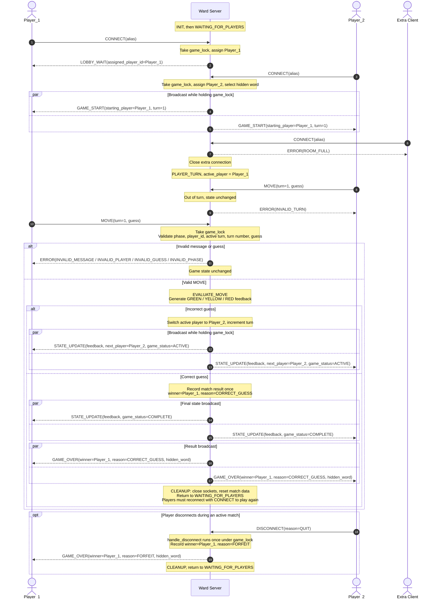

# Ward: Concurrency Design

**Student:** Atlas Middleton  
**Course:** CS457  
**Date:** 10/24/2026

## 1. Concurrency Model

**Option A: multi-threading with `threading.Thread`**. The main thread only calls `accept()`. Each accepted client gets its own worker thread, which services that client for the whole match. All shared game state is protected by one lock, `game_lock`, a `threading.RLock`.

I picked this because Ward has exactly two players, so thread overhead does not matter. A blocking `recv()` loop per client keeps the NDJSON receive buffer simple: each worker reads, appends to its own buffer, and pulls out complete lines. A quiet or slow client blocks only its own worker, never the main loop or the other player. A `selectors` design would avoid locks, but it would mean managing non-blocking sockets and partial reads and writes for every connection, which is not worth it for two clients.

Each client socket is blocking with a timeout of `IDLE_TIMEOUT_SECONDS` (300 seconds). For each client the server keeps a small connection record with its socket, a receive buffer for partial NDJSON lines, its player ID, and a `disconnected` flag.

## 2. Connection Lifecycle

1. **Listen:** At `INIT` the server creates a TCP socket, binds to the configured address and port, and starts listening. It then moves to `WAITING_FOR_PLAYERS`.
2. **Accept:** When a client connects, the main thread calls `accept()`, sets the socket timeout, and starts a new worker thread for it.
3. **Register:** The worker creates a connection record with no `player_id` yet and starts reading. A connection that has not sent `CONNECT` does not use up a player slot.
4. **Join:** The client sends `CONNECT`. Under `game_lock`, the server counts the players already assigned. If two are assigned, it sends `ERROR(ROOM_FULL)` and closes that socket. Otherwise the first client becomes `Player_1` and receives `LOBBY_WAIT`. The second becomes `Player_2`, the server selects the hidden word, and both clients receive `GAME_START` with `Player_1` as the starting player.
5. **Game loop:** Each worker keeps reading from its socket and extracts complete newline-terminated messages. Parsing and schema validation happen outside the lock. Valid messages are handled inside the lock according to the FSM. A correct guess ends with `STATE_UPDATE` and `GAME_OVER`.
6. **Teardown:** A client is removed when it sends `DISCONNECT`, when `recv()` returns `b""` (EOF), when `ConnectionResetError`, `BrokenPipeError`, or `ConnectionAbortedError` occurs, or when it is idle past the timeout (`TimeoutError`). All of these go through one `handle_disconnect()` routine. It sets the `disconnected` flag, awards a forfeit if a match is active, closes the socket, and lets the worker exit.
7. **Post-game reset:** After `GAME_OVER`, `CLEANUP` closes the client sockets, clears buffers, and resets match data. The server returns to `WAITING_FOR_PLAYERS`. Players must open a new connection and send `CONNECT` to play again.

**Capacity:** Exactly two players are assigned at once. A `CONNECT` that arrives while two players are assigned receives `ERROR(ROOM_FULL)` and its connection is closed, in every server state. The extra client never touches the match.

**Idle timeout:** A client that sends nothing for `IDLE_TIMEOUT_SECONDS` raises `TimeoutError` and is handled as a disconnect. The timeout is long enough that a player thinking about a guess is not dropped.

**Sending:** Sockets are blocking, so outgoing messages are sent with `sendall()`. Sockets have a timeout, so a send cannot block forever. If a send fails with `BrokenPipeError` or `ConnectionResetError`, the player is handled as disconnected. `GAME_OVER` is sent completely before the client sockets are closed.

## 3. Thread Safety and State Isolation

**Strategy: mutex-protected shared state.** Several worker threads run at the same time, so every shared resource is protected by the single lock `game_lock`. It is an `RLock` (reentrant) because `handle_disconnect()` can be triggered from inside a locked section, for example when a `send()` fails during a broadcast. A plain `Lock` would deadlock in that case.

**Shared resources and why each is protected:**

- **FSM state:** read and changed by both workers, so every state transition is a critical section.
- **`active_player` and `current_turn`:** they decide whose `MOVE` is valid, so checking and changing them must happen together.
- **Hidden word:** read during guess evaluation and reset at cleanup.
- **Connected client list and player assignments:** changed by `CONNECT`, teardown, and cleanup.
- **`match_result` (winner and reason):** must be recorded exactly once per match.
- **`disconnected` flags:** checked and set inside `handle_disconnect()` under the lock.
- **Not shared:** each worker's receive buffer and parsing state belong to one thread, so they need no lock.

**Places a race could happen, and why it does not:**

- **Both players send `MOVE` at once:** each worker waits for `game_lock`. The first one in is validated and applied. The second is then checked against the updated state and rejected with `ERROR(INVALID_TURN)`, so turn ownership cannot be corrupted.
- **Both clients send `CONNECT` at once:** assignment and the `ROOM_FULL` check run under the lock, so exactly one client becomes `Player_1`, one becomes `Player_2`, and any further client is rejected.
- **A player disconnects while a guess is evaluated:** `handle_disconnect()` needs the same lock, so it waits until evaluation and the broadcast finish. If the guess won, the result stands. Otherwise the forfeit is processed next.
- **`DISCONNECT` followed by EOF:** both call `handle_disconnect()`. The first sets the `disconnected` flag under the lock, so the second does nothing and there is no double forfeit.
- **Correct guess and disconnect at nearly the same time:** whichever gets the lock first records the result. `match_result` is written only if the game is not already over.
- **Both players disconnect:** the first disconnect awards a forfeit to the other player. If that player is also gone, `GAME_OVER` cannot be delivered, so the server closes the sockets and goes to `CLEANUP` with no winner.

**Lock pattern:**

```python
def worker(conn):
    while not conn.disconnected:
        try:
            data = conn.sock.recv(1024)             # blocking, no lock held
            if not data:
                handle_disconnect(conn)             # EOF
                return
            conn.buffer += data
            for raw_line in extract_complete_lines(conn.buffer):
                msg, err = parse_and_validate_schema(raw_line)   # no lock held
                if err:
                    send_error(conn, err)
                    continue
                with game_lock:                     # acquire
                    process_message(conn, msg)      # check phase, player, turn, guess,
                                                    # change state, broadcast
                                                    # release on leaving the block
        except (ConnectionResetError, BrokenPipeError,
                ConnectionAbortedError, TimeoutError):
            handle_disconnect(conn)
            return

def handle_disconnect(conn):
    with game_lock:                                 # RLock: safe if already held
        if conn.disconnected:                       # handle each disconnect once
            return
        conn.disconnected = True
        # forfeit if a match is active, otherwise release the slot
        conn.sock.close()
```

**Rules that keep it safe:** every change to shared state happens inside `with game_lock:`, `recv()` and parsing never run under the lock, only the server decides turns, winners, and state, and every departure goes through `handle_disconnect()`, which checks the `disconnected` flag first.

## 4. Turn and State Synchronization

Ward is turn-based, so only the active player may submit a valid `MOVE`. The diagram shows every message in the protocol: `CONNECT`, `LOBBY_WAIT`, `GAME_START`, `MOVE`, `STATE_UPDATE`, `ERROR`, `DISCONNECT`, and `GAME_OVER`.



**How it works:**

1. The active player sends `MOVE`. The worker receives and parses it outside the lock.
2. The worker takes `game_lock` and validates the move against the FSM: current phase, `player_id` matches the connection, sender is the active player, `turn` matches the current turn, and the guess has the right length and only letters.
3. An invalid or out-of-turn move gets an `ERROR` sent only to the sender. The game state does not change.
4. A valid guess moves the server to `EVALUATE_MOVE`. The server compares it to the hidden word and builds the `GREEN`/`YELLOW`/`RED` feedback.
5. If the guess is wrong, the server switches the active player, increments the turn, and sends `STATE_UPDATE` to both clients inside the same locked block.
6. If the guess is correct, the server records the result, sends a final `STATE_UPDATE` with `game_status` `COMPLETE`, then `GAME_OVER`, and enters `CLEANUP`.
7. If a player disconnects or times out during a match, the other player gets `GAME_OVER` with reason `FORFEIT`.

**What "synchronous broadcast" guarantees:** TCP cannot make two clients receive data at the same instant. What Ward guarantees is that both sends of a broadcast are issued while the same `game_lock` is held. No other move can be processed in between, so both clients see updates in the same order, and clients display only server-provided state. The `par` blocks in the diagram show this.

## 5. Result and Score Synchronization

Ward has no points system, so the score of a match is its result: the winner and the reason (`CORRECT_GUESS` or `FORFEIT`). The server keeps it in memory as `match_result` and writes it once, inside `game_lock`, only if the game is not already over. The server then sends it to every connected player in `GAME_OVER`, along with the hidden word. Clients never work out the result themselves. After `GAME_OVER`, `CLEANUP` closes the client sockets and resets `match_result`, `active_player`, `current_turn`, the hidden word, and player assignments. The listening socket stays open. Nothing carries over to the next match, so players reconnect with `CONNECT`.
