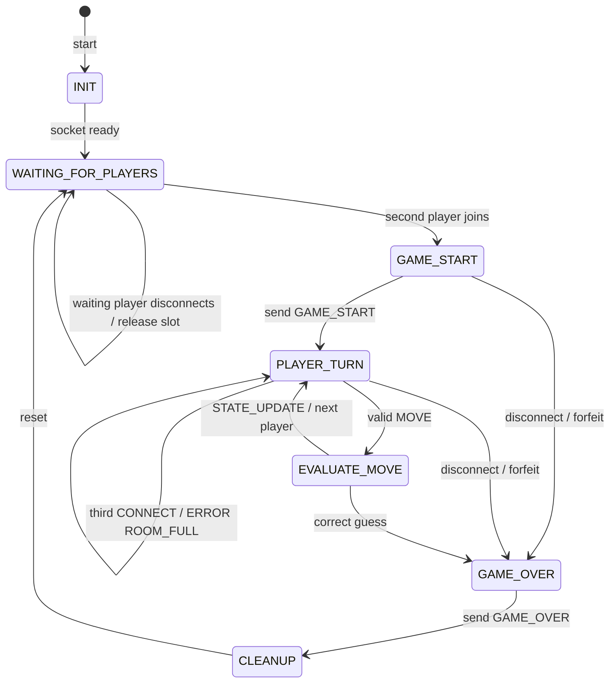
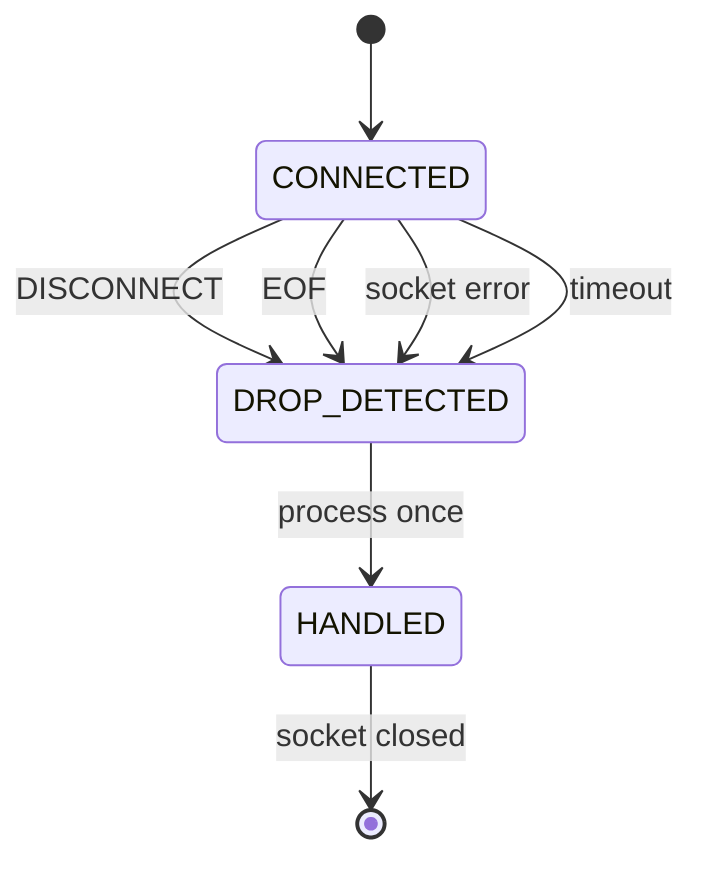

# Ward: FSM Specification

**Student:** Atlas Middleton  
**Course:** CS457  
**Date:** 10/24/2026

This document describes the server-side state machine for Ward. It uses the messages, error codes, and rules defined in `protocol_blueprint.md`.

The server is the authority for all game state. Clients only send `CONNECT`, `MOVE`, and `DISCONNECT` messages. The server validates all input, determines turn order, evaluates guesses, and broadcasts game state updates.

The server handles each client in its own thread. The current FSM state is shared data protected by `game_lock`, and every state transition in this document is a critical section. See `concurrency_design.md` for the locking rules.

---

# 1. Main State Diagram

A third `CONNECT` is rejected with `ERROR(ROOM_FULL)` in every state where two players are assigned (`GAME_START` through `CLEANUP`). Only `PLAYER_TURN` is drawn above to keep the diagram readable. The full list is in Section 3.

Complete transition details are described in Section 3.

---

# 2. State Descriptions

| State | Server actions |
| --- | --- |
| `INIT` | Server starts, creates listening TCP socket, initializes an empty game session. |
| `WAITING_FOR_PLAYERS` | Accepts `CONNECT` messages. The first client is `Player_1` and receives `LOBBY_WAIT`. The second client is `Player_2`. |
| `GAME_START` | Both players connected. Server selects hidden word and sends `GAME_START` to clients. `Player_1` always starts, with `turn` set to `1`. |
| `PLAYER_TURN` | Server waits for valid `MOVE` from the active player. Non-active players may not submit guesses. |
| `EVALUATE_MOVE` | Server validates guess, evaluates letter positions, generates feedback, updates active player, and checks for win-condition. |
| `GAME_OVER` | A player has guessed the hidden word correctly or an opponent has forfeited. The server sends `GAME_OVER` to clients. |
| `CLEANUP` | Server closes client sockets, clears buffers, resets game data, and prepares for new match. The listening socket stays open. |

---

# 3. Transition Table

| From | Trigger | Server Action | To |
| --- | --- | --- | --- |
| `INIT` | Socket initialized | Begin accepting connections | `WAITING_FOR_PLAYERS` |
| `WAITING_FOR_PLAYERS` | First valid `CONNECT` | Assign `Player_1`, send `LOBBY_WAIT` | `WAITING_FOR_PLAYERS` |
| `WAITING_FOR_PLAYERS` | Second valid `CONNECT` | Assign `Player_2` | `GAME_START` |
| `WAITING_FOR_PLAYERS` | Waiting player disconnects | Release player slot | `WAITING_FOR_PLAYERS` |
| Any state with two players assigned | `CONNECT` from another client | Send `ERROR (ROOM_FULL)`, close that connection | Same state |
| Any state with a player assigned | `CONNECT` from an already-joined client | Send `ERROR (INVALID_PHASE)` | Same state |
| `GAME_START` | Hidden word selected | Send `GAME_START` | `PLAYER_TURN` |
| `GAME_START` | Player disconnects | Award forfeit victory | `GAME_OVER` |
| `PLAYER_TURN` | Valid `MOVE` from active player | Validate guess and begin evaluation | `EVALUATE_MOVE` |
| `PLAYER_TURN` | Invalid `MOVE` or incorrectly formatted message | Send `ERROR` | `PLAYER_TURN` |
| `PLAYER_TURN` | Out-of-turn `MOVE` | Send `ERROR (INVALID_TURN)` | `PLAYER_TURN` |
| `PLAYER_TURN` | Player disconnects | Award forfeit victory | `GAME_OVER` |
| `EVALUATE_MOVE` | Guess does not match hidden word | Send `STATE_UPDATE`, switch active player, increment turn | `PLAYER_TURN` |
| `EVALUATE_MOVE` | Guess matches hidden word | Send final `STATE_UPDATE`, declare winner | `GAME_OVER` |
| `GAME_OVER` | Record result | Send `GAME_OVER` | `CLEANUP` |
| `CLEANUP` | Release resources | Reset game state | `WAITING_FOR_PLAYERS` |

An idle timeout (`IDLE_TIMEOUT_SECONDS` in `protocol_blueprint.md`) counts as a disconnect in every row above that handles a disconnect.

---

# 4. Valid Moves

A `MOVE` is valid if all of the following are true:

1. The message is within `MAX_MESSAGE_BYTES` and follows the schema defined in `protocol_blueprint.md`.
2. The server is currently in `PLAYER_TURN`.
3. The `player_id` matches the connection that submitted the message.
4. The sender is the active player.
5. The `turn` value matches the server's current turn number.
6. The guess length matches `WORD_LENGTH`.
7. The guess contains only alphabetic characters (`A` to `Z`, case-insensitive).

The server checks these in the order listed in Section 5. A valid guess causes the server to transition to `EVALUATE_MOVE`.

---

# 5. Invalid Moves and Bad Messages

Invalid input doesn't crash the server loop or change game state.

The server sends one `ERROR` message to the client that caused the problem and remains in the current state.

## Validation Order

The server rejects a message with the first error that applies, in this order:

1. `MESSAGE_TOO_LARGE`
2. `INVALID_MESSAGE`
3. `INVALID_PHASE`
4. `INVALID_PLAYER`
5. `INVALID_TURN`
6. `INVALID_GUESS`

Checks 5 and 6 apply only to `MOVE`.

| Situation | Error Code | State After |
| --- | --- | --- |
| Invalid JSON, invalid UTF-8, unknown message type, missing fields, invalid alias | `INVALID_MESSAGE` | Same state |
| `player_id` does not match connection or player never joined | `INVALID_PLAYER` | Same state |
| Incorrect word length or invalid characters | `INVALID_GUESS` | Same state |
| Guess submitted by non-active player, or `turn` value does not match | `INVALID_TURN` | Same state |
| Message not allowed in current state, or `CONNECT` from an already-joined client | `INVALID_PHASE` | Same state |
| `CONNECT` while two players are already assigned | `ROOM_FULL` | Connection closed |
| Message exceeds `MAX_MESSAGE_BYTES` | `MESSAGE_TOO_LARGE` | Connection closed |

When `MESSAGE_TOO_LARGE` closes the connection of an assigned player, the closure is handled as a disconnect (Section 6).

## Out-of-Turn Moves

An out-of-turn move occurs when:

- The non-active player submits a `MOVE` during `PLAYER_TURN`. The server replies with `INVALID_TURN`.
- A `MOVE` is sent before `GAME_START`. The server replies with `INVALID_PHASE`.
- A `MOVE` is sent during `EVALUATE_MOVE`. The server replies with `INVALID_PHASE`.
- A `MOVE` is sent after `GAME_OVER`. The server replies with `INVALID_PHASE`.

The server ignores the request. Because `EVALUATE_MOVE` runs while `game_lock` is held, a worker thread normally cannot observe that state, and a move that arrives during evaluation is processed afterward against the updated state.

---

# 6. Unexpected Disconnections

The server treats the following situations as disconnects:

- The client sends a `DISCONNECT` message.
- `recv()` returns `b""` (EOF).
- `ConnectionResetError`.
- `BrokenPipeError`.
- `ConnectionAbortedError`.
- Socket timeout (`IDLE_TIMEOUT_SECONDS`).

## Disconnect Handling by State

| Server State | Server Action |
| --- | --- |
| `WAITING_FOR_PLAYERS` | Release disconnected player's slot and continue waiting for another player. |
| `GAME_START` | Remaining player wins by forfeit. |
| `PLAYER_TURN` | Remaining player wins by forfeit and receives `GAME_OVER`. |
| `EVALUATE_MOVE` | The disconnect is handled after the evaluation finishes, because both need `game_lock`. If the guess was correct, the winner is already recorded and the result stands. Otherwise the remaining player wins by forfeit. |
| `GAME_OVER` | Result already recorded. Disconnect does not change the outcome. |
| `CLEANUP` | No additional action required. |

## Both Players Disconnect

If both connections are lost before a winner is recorded, the server enters `CLEANUP` without assigning a winner. No `GAME_OVER` is sent because no client remains.

## Send Failures

If a `BrokenPipeError` occurs while sending `GAME_OVER`, the server closes the socket and continues to `CLEANUP`.

## Handle Each Disconnect Once

The server marks a player as disconnected the first time a disconnect event occurs. A `DISCONNECT` message followed by EOF does not trigger multiple forfeits.

---

# 7. Guess Evaluation (Inside `EVALUATE_MOVE`)

1. Validate the guess format and length.
2. Convert the guess to uppercase and compare it against the hidden word.
3. Assign feedback values (`GREEN`, `YELLOW`, `RED`) for each character using the two-pass rule in `protocol_blueprint.md`: greens first, then yellows limited by the remaining unmatched letters of the hidden word.
4. Check whether the guess exactly matches the hidden word.
5. If the hidden word was guessed correctly, declare a winner and transition to `GAME_OVER`.
6. Otherwise send `STATE_UPDATE` with `game_status` `ACTIVE`.
7. Switch the active player and increment the turn number.
8. Return to `PLAYER_TURN`.

When the game continues, the `STATE_UPDATE` message contains the guess results and identifies the next active player.

When the game ends, the server sends a final `STATE_UPDATE` with `game_status` `COMPLETE` and `next_player` `null`, followed by a `GAME_OVER` message.

---

# 8. Post-Game Reset

After `GAME_OVER`, the server enters `CLEANUP`.

The server finishes sending `GAME_OVER` to every connected player before closing their sockets.

During cleanup the server:

- Closes active client sockets. The listening socket stays open.
- Clears receive buffers.
- Removes stored game data, including the match result.
- Removes stored turn information.
- Deletes the active hidden word.
- Resets player assignments.

After cleanup the server returns to `WAITING_FOR_PLAYERS`.

Players must open a new connection and send `CONNECT` to begin a new match.
